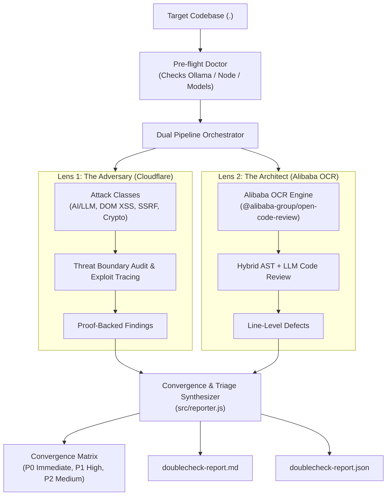

# `doublecheck` 🔍⚖️

<p align="center">
  <strong>Multi-Perspective Code Security & Architecture Review for Humans and AI Agents.</strong><br>
  <em>Because the best code reviews happen when the Attacker and the Architect sit at the same table.</em>
</p>

<p align="center">
  <a href="https://github.com/poferraz/doublecheck/actions"></a>
  <a href="https://ollama.com"></a>
  <a href="https://github.com/cloudflare/security-audit-skill"></a>
  <a href="https://github.com/alibaba/open-code-review"></a>
  <a href="LICENSE"></a>
</p>

---

## ⚡ The Core Problem

Traditional code reviews suffer from **single-lens blindness**:
- **Linters & Static Analyzers** flag indentation and local syntax issues, but are completely blind to multi-step prompt injection, SSRF, and trust-boundary violations.
- **Security Penetration Scanners** find theoretical attack vectors, but miss core software engineering bugs like unhandled async rejections, null dereferences, and state race conditions.

`doublecheck` unifies two world-class security and engineering methodologies into an automated, zero-cost pipeline:

| Dimension | The Attacker Lens | The Architect Lens |
| :--- | :--- | :--- |
| **Methodology** | [**Cloudflare Security Audit Standard**](https://github.com/cloudflare/security-audit-skill) | [**Alibaba Open Code Review**](https://github.com/alibaba/open-code-review) |
| **Perspective** | **Penetration Tester / Red Teamer** | **Principal Engineer / Staff Architect** |
| **Focus** | Exploit chains, AI/LLM prompt injection, SSRF, DOM XSS, crypto tampering | AST invariants, null safety, async leaks, type coercion traps, stability |
| **Key Output** | Proof-backed vulnerability findings (`findings.json`) | Line-level production defect annotations (`comments.json`) |

When **both lenses independently flag the exact same line of code**, `doublecheck` declares a **Converged High-Confidence Defect (Priority 0)**.

---

## 🧠 System Architecture



---

## 🚀 1-Minute Quickstart

### 1. Terminal / Human CLI Mode
Run directly with `npx` (zero global installation required). Runs **100% locally on your machine via Ollama with zero API keys**:

```bash
# Run full dual audit on current directory
npx @poferraz/doublecheck .

# Run on specific directory using a specific Ollama model
npx @poferraz/doublecheck ./src --model deepseek-v4.1-flash:1017-cloud

# Export to both Markdown and machine-readable JSON
npx @poferraz/doublecheck . --format both -o security-report.md
```

### 2. AI Coding Agent Mode
`doublecheck` is a first-class **Agent Skill** formatted to the open [Agent Skills specification](https://agentskills.io/specification).

Install in your runtime:
```bash
# Google Antigravity
git clone https://github.com/poferraz/doublecheck.git
bash doublecheck/scripts/convert.sh antigravity

# Claude Code
bash doublecheck/scripts/convert.sh claude

# Cursor (.cursor/rules/)
bash doublecheck/scripts/convert.sh cursor
```

In your agent session:
```markdown
/doublecheck
```

---

## 🔬 Real-World Pilot Audit Findings

During validation across production repositories, `doublecheck` proved its convergence theorem:

| Vulnerability / Defect | Location | Cloudflare Adversary Finding | Alibaba Architect Finding | Result |
| :--- | :--- | :--- | :--- | :---: |
| **Open SSRF Proxy** | `api/ai-proxy.js:29` | **CRITICAL:** Unrestricted serverless forward proxy to cloud metadata (`169.254.169.254`) and internal VPC. | **CRITICAL:** Caller controls destination with wildcard CORS relaying credentials. | **100% Convergence (P0)** |
| **DOM XSS Sink** | `src/main.js:379` | **HIGH:** Unescaped error message interpolated directly into `document.body.innerHTML`. | **CRITICAL:** Caught error message introduces DOM-based script injection sink. | **100% Convergence (P0)** |
| **Cleartext Secrets** | `src/ui/storage.ts:63` | **CRITICAL:** OAuth client secrets and AI API keys written directly to `document.cookie`. | **HIGH:** Cleartext storage readable across origin without Secure/HttpOnly flags. | **100% Convergence (P0)** |
| **Injection Bypass** | `src/firewall/injection.ts:19` | **HIGH:** 8-character Cyrillic normalizer bypassed by zero-width spaces (`\u200B`). | **HIGH:** Incomplete confusable mapping allows regex rule circumvention. | **100% Convergence (P0)** |
| **Runtime Crash** | `src/domain/giant.js:3` | *Covered* | **HIGH:** Partial threshold configs not merged with defaults, throwing unhandled `TypeError`. | **Architect Defect (P1)** |

---

## 🛠️ Requirements & Model Policy

- **Node.js:** `>= 20.0.0` (Active LTS)
- **Inference:** Local [Ollama](https://ollama.com) (Recommended: `deepseek-v4.1-flash`, `qwen2.5-coder:14b`, or `mistral-large`).
- **Cost:** **$0.00** — zero mandatory external subscriptions, zero proprietary API tokens, zero data sent over the wire.

---

## 🤝 Contributing

Contributions are warmly welcomed! Please see [CONTRIBUTING.md](CONTRIBUTING.md) for details on adding new attack classes or AST inspection rulesets.

## 🛡️ Security

Please review our [SECURITY.md](SECURITY.md) for vulnerability disclosure practices.

---

## 📄 License

Apache License 2.0 © 2026 [Paulo Ferraz](https://github.com/poferraz).
