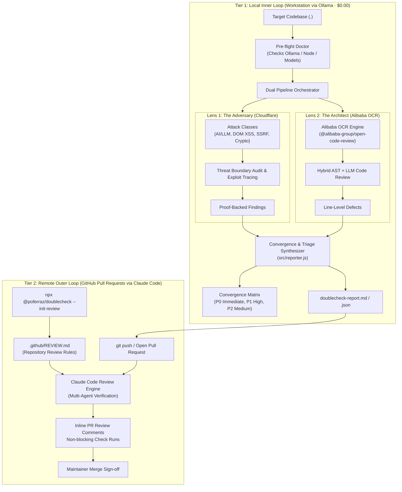

<p align="center">
# `doublecheck`
</p>


<p align="center">
  <strong>Multi-Perspective Code Security & Architecture Review for Humans, CI/CD, and AI Coding Agents.</strong><br>
  <em>Because the best code reviews happen when the Attacker, the Architect, and Continuous PR Review sit at the same table.</em>
</p>

<p align="center">
  <a href="https://github.com/poferraz/doublecheck/releases/latest"></a>
  <a href="https://github.com/poferraz/doublecheck/actions"></a>
  <a href="https://ollama.com"></a>
  <a href="https://github.com/cloudflare/security-audit-skill"></a>
  <a href="https://github.com/alibaba/open-code-review"></a>
  <a href="https://code.claude.com/docs/en/code-review"></a>
  <a href="https://agentskills.io"></a>
  <a href="package.json"></a>
  <a href="CONTRIBUTING.md"></a>
  <a href="LICENSE"></a>
</p>

```text
$ npx @poferraz/doublecheck .

[doublecheck] Running pre-flight environment checks...
✔ Local Ollama connected at http://localhost:11434 (deepseek-v4.1-flash)
✔ Alibaba Open Code Review (ocr) engine active

[doublecheck] Starting Dual-Perspective Audit on ./src...
  1. Lens 1: The Adversary (Cloudflare Security Audit Standard)
  2. Lens 2: The Principal Architect (Alibaba Open Code Review)

⚖️  CROSS-AUDIT CONVERGENCE DETECTED:
┌──────────────────────────────────────────────────────────────────────────────┐
│ 🚨 PRIORITY 0 IMMEDIATE BLOCKER: api/ai-proxy.js:29                          │
│ • Cloudflare Adversary: CRITICAL — Unrestricted serverless forward proxy     │
│                         to cloud metadata (169.254.169.254).                 │
│ • Alibaba Architect:    CRITICAL — Wildcard CORS credential relay on fetch() │
│ ↳ CONVERGENCE CONFIDENCE: 100% (Both independent lenses flagged same line)   │
└──────────────────────────────────────────────────────────────────────────────┘

✔ Audit Complete: 1 Converged P0 Defect | Reports: doublecheck-report.md
```

---

## 📑 Table of Contents

- [⚡ The Core Problem](#-the-core-problem)
- [🏆 Why `doublecheck`?](#-why-doublecheck)
- [🧠 System Architecture & Defense-in-Depth](#-system-architecture--defense-in-depth)
- [🚀 Quickstart](#-quickstart)
  - [1. Terminal / Human CLI Mode](#1-terminal--human-cli-mode)
  - [2. Claude Code Review PR Integration](#2-claude-code-review-pr-integration)
  - [3. AI Coding Agent Skill Mode](#3-ai-coding-agent-skill-mode)
  - [4. GitHub Actions CI/CD Pipeline](#4-github-actions-cicd-pipeline)
- [⚙️ CLI Arguments & Options Reference](#️-cli-arguments--options-reference)
- [💻 Supported Local Ollama Models & Hardware](#-supported-local-ollama-models--hardware)
- [🔬 Real-World Pilot Audit Findings](#-real-world-pilot-audit-findings)
- [📦 Releases & Versioning](#-releases--versioning)
- [🤝 Contributing](#-contributing)
- [🛡️ Security Policy](#️-security-policy)
- [📄 License](#-license)

---

## ⚡ The Core Problem

Traditional code reviews suffer from **single-lens blindness**:
- **Linters & Static Analyzers** flag indentation and local syntax issues, but are completely blind to multi-step prompt injection, SSRF, and trust-boundary violations.
- **Security Penetration Scanners** find theoretical attack vectors, but miss core software engineering bugs like unhandled async rejections, null dereferences, and state race conditions.
- **Raw LLM Prompts** suffer from high false-positive hallucination rates and lack ground-truth AST invariant verification.

`doublecheck` unifies two world-class security and engineering methodologies into an automated, zero-cost pipeline, backed by continuous pull request enforcement:

| Dimension | Lens 1: The Attacker | Lens 2: The Architect | Continuous PR Gate |
| :--- | :--- | :--- | :--- |
| **Methodology** | [**Cloudflare Security Audit**](https://github.com/cloudflare/security-audit-skill) | [**Alibaba Open Code Review**](https://github.com/alibaba/open-code-review) | [**Claude Code Review**](https://code.claude.com/docs/en/code-review) |
| **Perspective** | **Penetration Tester / Red Teamer** | **Principal Engineer / Staff Architect** | **Multi-Agent PR Reviewer** |
| **Focus** | Exploit chains, AI prompt injection, SSRF, DOM XSS, crypto tampering | AST invariants, null safety, async leaks, type coercion traps, stability | Pull request diffs, repository context, team guidelines (`REVIEW.md`) |
| **Key Output** | Proof-backed vulnerability findings (`findings.json`) | Line-level production defect annotations (`comments.json`) | GitHub inline PR annotations and check runs |

When **both local lenses independently flag the exact same line of code**, `doublecheck` declares a **Converged High-Confidence Defect (Priority 0)**.

---

## 🏆 Why `doublecheck`?

| Capability | Traditional Linters (ESLint / Biome) | SAST Tools (Snyk / SonarQube) | Raw LLM Prompts (ChatGPT / Copilot) | Native Claude Code Review | **`doublecheck` (Unified)** |
| :--- | :---: | :---: | :---: | :---: | :---: |
| **Inference Cost** | $0.00 | Paid / Tiered | API tokens ($$) | Team / Enterprise API | **$0.00 (Local Ollama)** |
| **Data Privacy** | 100% Local | Code uploaded to cloud | Cloud-hosted | Cloud-hosted | **100% Local / Zero Cloud** |
| **Cross-Audit Convergence** | ❌ No | ❌ No | ❌ No | ❌ No | **✅ Yes (P0 Dual-Lens)** |
| **Deep Threat Modeling** | ❌ No | ⚠️ Rule-based only | ⚠️ Unreliable lines | ✅ Multi-agent | **✅ Cloudflare 12-Class Hunt** |
| **AST Invariant Verification** | ⚠️ Syntax only | ⚠️ Pattern matching | ❌ No AST engine | ⚠️ General reasoning | **✅ Alibaba Hybrid AST + LLM** |
| **Continuous PR Gate (`REVIEW.md`)** | ❌ No | ⚠️ CI check only | ❌ No | ✅ Native PR review | **✅ Auto-generated via CLI** |

---

## 🧠 System Architecture & Defense-in-Depth

`doublecheck` operates as a two-tier **Defense-in-Depth** system:
1. **Tier 1 (Inner Loop):** Runs locally on your workstation via Ollama before committing. Eliminates high-confidence converged defects at zero cost without sending private IP over the wire.
2. **Tier 2 (Outer Loop):** Automatically triggered on GitHub pull requests. [Claude Code Review](https://code.claude.com/docs/en/code-review) reads `.github/REVIEW.md` (generated via `npx @poferraz/doublecheck --init-review`) and applies whole-repository multi-agent verification before merge.



---

## 🚀 Quickstart

### 1. Terminal / Human CLI Mode
Run directly with `npx` (zero global installation required). Runs **100% locally on your machine via Ollama with zero API keys**:

```bash
# Run full dual audit on current directory
npx @poferraz/doublecheck .

# Run on specific directory using a specific Ollama model
npx @poferraz/doublecheck ./src --model deepseek-v4.1-flash:1017-cloud

# Export to both Markdown and machine-readable JSON
npx @poferraz/doublecheck . --format both -o security-report.md

# Run pre-flight environment checks only
npx @poferraz/doublecheck --doctor-only
```

### 2. Claude Code Review PR Integration
Bridge `doublecheck`'s multi-perspective rules directly into GitHub pull requests analyzed by Anthropic's [Claude Code Review](https://code.claude.com/docs/en/code-review):

```bash
# Bootstrap .github/REVIEW.md in your repository
npx @poferraz/doublecheck --init-review

# Or export for a target directory
npx @poferraz/doublecheck ./my-repo --init-review
```

This generates a ready-to-commit `.github/REVIEW.md` that directs Claude Code Review to enforce the Cloudflare attack classes, Alibaba architectural invariants, and convergence escalation criteria on every PR.

### 3. AI Coding Agent Skill Mode
`doublecheck` is formatted to the open [Agent Skills specification](https://agentskills.io/specification). Install directly into your AI coding assistant:

```bash
# Google Antigravity
git clone https://github.com/poferraz/doublecheck.git
bash doublecheck/scripts/convert.sh antigravity

# Claude Code (~/.claude/skills/doublecheck)
bash doublecheck/scripts/convert.sh claude

# Cursor IDE (.cursor/rules/)
bash doublecheck/scripts/convert.sh cursor

# Windsurf (.windsurfrules)
bash doublecheck/scripts/convert.sh windsurf

# OpenAI Codex (AGENTS.md)
bash doublecheck/scripts/convert.sh codex
```

In your agent session:
```markdown
/doublecheck
```

### 4. GitHub Actions CI/CD Pipeline
Enforce `doublecheck` audits automatically on pull requests using GitHub Actions:

```yaml
# .github/workflows/doublecheck.yml
name: Doublecheck Security Audit

on:
  pull_request:
    branches: [ main ]

jobs:
  audit:
    runs-on: ubuntu-latest
    steps:
      - uses: actions/checkout@v4

      - name: Setup Node.js
        uses: actions/setup-node@v4
        with:
          node-version: '20'

      - name: Verify Claude Code Review Configuration
        run: test -f .github/REVIEW.md || npx @poferraz/doublecheck --init-review

      - name: Run doublecheck pre-flight doctor
        run: npx @poferraz/doublecheck --doctor-only
```

---

## ⚙️ CLI Arguments & Options Reference

| Argument / Flag | Type | Default | Description |
| :--- | :---: | :---: | :--- |
| `path` | `string` | `.` | Target directory or file to audit. |
| `-m, --model <name>` | `string` | *auto-detected* | Custom Ollama model tag (e.g., `deepseek-v4.1-flash`, `qwen2.5-coder:14b`). |
| `--ollama <url>` | `string` | `http://localhost:11434` | Base URL of the local or remote Ollama daemon. |
| `-f, --format <format>` | `string` | `markdown` | Report format: `markdown`, `json`, or `both`. |
| `-o, --output <file>` | `string` | `doublecheck-report.md` | Destination file for the generated report. |
| `--init-review` | `boolean` | `false` | Generates `.github/REVIEW.md` tailored for Claude Code Review. |
| `--doctor-only` | `boolean` | `false` | Verifies local Ollama, model availability, and OCR engine, then exits. |
| `--findings <file>` | `string` | `""` | Path to pre-computed Cloudflare findings JSON. |
| `-h, --help` | `boolean` | `false` | Displays CLI usage help and exit. |

---

## 💻 Supported Local Ollama Models & Hardware

`doublecheck` auto-detects the best available model on your local Ollama daemon in priority order:

| Model Tag | Recommended Role | Minimum RAM | Recommended VRAM | Speed / Precision Profile |
| :--- | :--- | :---: | :---: | :--- |
| `deepseek-v4.1-flash:1017-cloud` | **Default / Recommended** | 8 GB | 6 GB | ⚡⚡⚡ High speed, optimal prompt injection & AST reasoning. |
| `qwen2.5-coder:14b` | **High Precision Workstation** | 16 GB | 12 GB | ⚡⚡ State-of-the-art AST invariant and null-safety detection. |
| `qwen2.5-coder:7b` | **Lightweight / Laptop** | 8 GB | 4 GB | ⚡⚡⚡ Fast execution for quick pre-commit audits. |
| `mistral-large` | **Deep Architectural Reasoning** | 32 GB | 24 GB | ⚡ Thorough threat modeling across large multi-file boundaries. |
| `llama3.3:70b` | **Enterprise Self-Hosted Server** | 64 GB | 48 GB | ⚡ Exhaustive multi-class adversarial vulnerability tracing. |

---

## 🔬 Real-World Pilot Audit Findings

During validation across production repositories, `doublecheck` proved its convergence theorem:

| Vulnerability / Defect | Location | Cloudflare Adversary Finding | Alibaba Architect Finding | Result |
| :--- | :--- | :--- | :--- | :---: |
| **Open SSRF Proxy** | `api/ai-proxy.js:29` | **CRITICAL:** Unrestricted serverless forward proxy to cloud metadata (`169.254.169.254`) and internal VPC. | **CRITICAL:** Caller controls destination with wildcard CORS relaying credentials. | **100% Convergence (P0)** |
| **DOM XSS Sink** | `src/main.js:379` | **HIGH:** Unescaped error message interpolated directly into `document.body.innerHTML`. | **CRITICAL:** Caught error message introduces DOM-based script injection sink. | **100% Convergence (P0)** |
| **Cleartext Secrets** | `src/ui/storage.ts:63` | **CRITICAL:** OAuth client secrets and AI API keys written directly to `document.cookie`. | **HIGH:** Cleartext storage readable across origin without Secure/HttpOnly flags. | **100% Convergence (P0)** |
| **Injection Bypass** | `src/firewall/injection.ts:19` | **HIGH:** 8-character Cyrillic normalizer bypassed by zero-width spaces (`\u200B`). | **HIGH:** Incomplete confusable mapping allows regex rule circumvention. | **100% Convergence (P0)** |
| **Runtime Crash** | `src/domain/giant.js:3` | *Covered* | **HIGH:** Partial threshold configs not merged with defaults, throwing unhandled `TypeError`. | **Architect Defect (P1)** |

---

## 📦 Releases & Versioning

`doublecheck` adheres to [Semantic Versioning](https://semver.org/):
- Review the complete release history in [CHANGELOG.md](CHANGELOG.md).
- Track upcoming and published releases on [GitHub Releases](https://github.com/poferraz/doublecheck/releases).

---

## 🤝 Contributing

Contributions are warmly welcomed! Please see [CONTRIBUTING.md](CONTRIBUTING.md) for details on adding new attack classes, AST inspection rulesets, and release workflows.

## 🛡️ Security Policy

Please review our [SECURITY.md](SECURITY.md) for our vulnerability disclosure policy and execution sandboxing guarantees.

---

## 📄 License

Apache License 2.0 © 2026 [Paulo Ferraz](https://github.com/poferraz).
