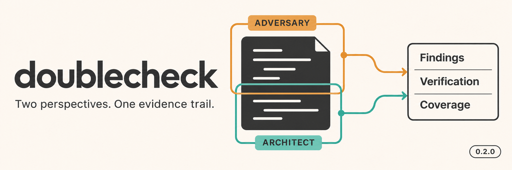

# Doublecheck

Doublecheck helps maintainers decide whether a code review is ready to act on. Its Markdown and JSON reports show which files were reviewed, what the tools flagged, and which findings have supporting evidence. A review with zero findings can still be incomplete.



[Still image](https://raw.githubusercontent.com/poferraz/doublecheck/main/docs/assets/doublecheck-hero.png) · [CI results](https://github.com/poferraz/doublecheck/actions/workflows/ci.yml)

## Install

The published CLI and JavaScript library require Node.js 20 or newer. From your project directory, install the released version and check its commands.

```sh
npm install --save-dev @poferraz/doublecheck@0.2.0
npx doublecheck --help
```

After installation, `npx doublecheck . --init-review` works offline. It creates a root `REVIEW.md` for an already configured review service. If custom instructions exist, the command preserves them unless you explicitly use `--force`. See the [release and API migration notes](docs/RELEASE_0.2.0.md).

## How to read a report

Start with **Engine Coverage**. In the default dual review, both the security and architecture reviews must account for the selected files. In architecture-only mode, only the architecture review is required. Alibaba Open Code Review (OCR) 1.13.3 does not provide a file coverage manifest for native scans. A successful native run therefore still reports partial coverage and exits with code 2.

Then inspect the confirmed findings and unresolved candidates. Confirmed findings meet the report's verification requirements. Unresolved candidates need investigation. Rejected findings stay in the record. Two reviewers flagging the same lines is a reason to look more closely. Each finding keeps its own verification state.

| Exit code | Meaning |
| --- | --- |
| `0` | Required coverage is complete. No confirmed high or critical findings or unresolved high, critical or unrated candidates remain. |
| `1` | Required coverage is complete and there is a confirmed high or critical finding, with no unresolved blocking candidate. |
| `2` | Coverage is incomplete, a blocking candidate is unresolved, or a required step failed. Read the coverage and diagnostics before accepting the review. |

To inspect an existing v2 JSON report locally, pass its parsed contents to the library's `getReviewExitCode`. This operation runs without model access. See the [library contract](docs/RELEASE_0.2.0.md#library-migration).

## Optional inference and privacy

A native architecture review uses OCR 1.13.3 and a configured, tool-capable Ollama-compatible model. OCR can send the selected source to that provider. `--doctor-only` can check the configuration before a review. It contacts the configured endpoint. A loopback address can still forward requests to a cloud model, so check your provider's routing before using private code.

The CLI can import existing security findings with `--findings file.json`. It reads records in Cloudflare's format. In dual mode, it also checks the native architecture provider. If that check fails, usable imported findings are saved in a partial report.

**Source checkout.** Default reports go in a private temporary directory. The CLI prints their location. Use `--output` to keep a report beyond OS cleanup. Failed native preflight writes a failed or partial report and exits 2. Off-host endpoints require HTTPS and `--allow-remote`. **Published npm 0.2.0** predates these changes and writes default reports in the working directory. Reports may contain source excerpts and absolute paths. See the [security policy](SECURITY.md) and [0.2.0 provider setup](https://github.com/poferraz/doublecheck/blob/27e34ab4987614e03a0fbb702cf813b5a7ab39f8/README.md#configure-and-run-a-native-scan).

## Maintainer decisions

I maintain Doublecheck with AI coding assistance. A self-review timed out before it produced a usable report. I kept recovered observations visible as candidates and made missing coverage produce an incomplete result in CI. On a later run, a model flagged a benign parser because it assumed the function had promised never to throw. That claim stayed unconfirmed. These results explain why a reader can see the evidence behind each finding and the limits of the review. [Recovery change](https://github.com/poferraz/doublecheck/commit/52b0e5012bd930bf6e1dfa55931e6b85f98ffba3) · [Release validation](https://github.com/poferraz/doublecheck/blob/main/docs/verification/2026-11-09-release-readiness.md)

## Project guide

| If you need to… | Start here |
| --- | --- |
| Use the library or migrate a caller | [0.2.0 API and report contract](docs/RELEASE_0.2.0.md) |
| Find the CLI or library source | [CLI entry point](bin/doublecheck.js) and [public JavaScript API](src/index.js) |
| Use the review instructions in a supported host | [Agent skill](skills/doublecheck/SKILL.md) and [host exports](CONTRIBUTING.md#host-exports) |
| Run the tests or report a problem | [Contributing](CONTRIBUTING.md) and [private security reporting](SECURITY.md#reporting) |

Doublecheck is licensed under Apache-2.0. The imported findings schema comes from Cloudflare and retains its MIT license. The optional native engine is Alibaba Open Code Review. [Project license](LICENSE) · [Schema license](src/schemas/CLOUDFLARE-LICENSE) · [Pinned schema source](https://github.com/cloudflare/security-audit-skill/tree/c1c8a8c1471069fb0e188eeaff69b8e8db6564a8) · [Alibaba Open Code Review](https://github.com/alibaba/open-code-review)
