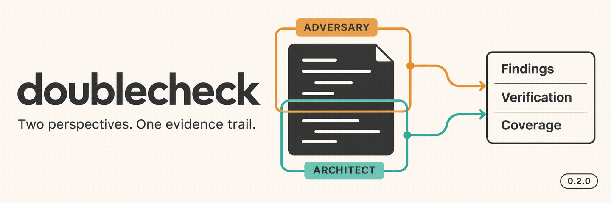

# doublecheck



[View the still hero](https://raw.githubusercontent.com/poferraz/doublecheck/main/docs/assets/doublecheck-hero.png)

Evidence-aware code security and architecture review for developers and AI coding agents.

[](https://github.com/poferraz/doublecheck/actions/workflows/ci.yml)

Version **0.2.0** is published on [npm](https://www.npmjs.com/package/@poferraz/doublecheck/v/0.2.0) and as a [GitHub release](https://github.com/poferraz/doublecheck/releases/tag/v0.2.0). It introduces report schema v2 and changes the library result contract. Read the [0.2.0 release and migration notes](docs/RELEASE_0.2.0.md) before upgrading.

Doublecheck validates review findings, preserves verification state and scan coverage, correlates exact source locations, and writes Markdown/JSON reports. An adversary review looks for exploitable trust-boundary failures; an architect review looks for correctness and lifecycle defects. Their overlap is evidence to investigate, not proof of a critical vulnerability.

## Current capabilities and limits

| Input or mode | Behavior |
| --- | --- |
| Native Alibaba OCR 1.13.3 | Runs a full-file scan using an explicitly selected custom provider. Comments remain candidates. |
| `--findings file.json` | Imports Cloudflare-format records; it does not execute Cloudflare's security-audit workflow. |
| Default `--mode dual` | Requires adversary and architect coverage. An absent lens cannot be reported as a complete dual review. |
| `--mode architect` | Requires only architect coverage; the unrequested adversary lens is labeled skipped. |
| Coverage unavailable | Report is partial, even if there are no findings. OCR 1.13.3 `scan` currently has no coverage manifest, so its full-file scans remain partial. |
| Agent skill | Guides a host agent through evidence gathering and verification; actual host/model quality requires separate evaluation. |
| Root `REVIEW.md` | Supplies guidance to an already configured Claude Code Review service; it does not install the service or enforce a merge gate. |

## Install

Requires Node.js `>=20.0.0`. Install the published CLI globally:

```bash
npm install --global @poferraz/doublecheck@0.2.0
doublecheck --help
doublecheck ./my-repo --init-review
```

For a project-local CLI and the library API, run this in your project:

```bash
npm install @poferraz/doublecheck@0.2.0
npx doublecheck --help
```

Help and review-instruction initialization do not run inference. Native scans additionally require OCR `1.13.3` and a reachable Ollama daemon with an installed tool-capable model. Check model quality and tool support for your chosen model.

## Configure and run a native scan

Configure a **custom** OCR provider manually. These commands change your OCR configuration; Doublecheck does not run them for you. Use the same installed model name throughout:

```bash
ocr config set provider ollama
ocr config set custom_providers.ollama.url http://localhost:11434/v1
ocr config set custom_providers.ollama.protocol openai
ocr config set custom_providers.ollama.model qwen3:8b
ocr config set custom_providers.ollama.api_key ollama

doublecheck --doctor-only --model qwen3:8b
doublecheck . --mode architect --model qwen3:8b --format both -o review.json
doublecheck . --findings findings.json --model qwen3:8b
```

Use `npx doublecheck` in place of `doublecheck` for a project-local installation.

The placeholder key is required by OCR's custom-provider configuration; it is not a cloud API credential. Doublecheck rejects built-in OCR provider names for custom routing, checks the named provider's URL, protocol, and installed model, and requires remote opt-in when Ollama reports remote model backing. These checks run again before native execution. It rejects credential commands for that provider and does not silently use an ambient cloud provider.

A loopback endpoint does not prove local inference: a daemon or proxy can forward requests. Remote endpoints and cloud-tagged models require `--allow-remote`; that flag is consent to routing, not a guarantee about provider data handling. Configure your daemon's cloud policy separately. See [SECURITY.md](SECURITY.md).

## Reports and exit codes

JSON uses `schemaVersion: "doublecheck/report/v2"` and contains `status`, `engines`, the full canonical `findings` list, `correlations`, confirmed `p0/p1/p2`, `unrated`, `unresolved`, `rejected`, and diagnostics.

- **Confirmed** records require the supported verification contract. Native OCR comments and historical records without verdicts remain **needs_validation** candidates.
- **Rejected** records remain separate and never become blockers through correlation.
- Missing severity remains **Unrated**. Malformed records produce diagnostics; valid siblings are retained.
- Exact content duplicates collapse; same-title or same-line distinct findings survive.
- Correlations require exact canonical file identity and overlapping known line ranges. Missing lines and nearby lines do not count.

| Exit | Meaning |
| --- | --- |
| `0` | Required coverage is complete, with no confirmed high/critical finding or unresolved high/critical/unrated candidate. Lower-severity candidates remain visible. |
| `1` | Required coverage is complete and confirmed high/critical findings exist. |
| `2` | Review is incomplete/failed, high/critical/unrated candidates remain unresolved, or invocation/preflight/output fails. Incompleteness takes precedence. |

A report with no findings and unknown coverage means the engine did not establish which files completed. It exits **2**; inspect Engine Coverage and Diagnostics before deciding how to continue. A zero count is not a completed review.

Native execution metadata distinguishes process success, timeout, and failure from review coverage. Requested provider/model/endpoint are retained separately from actual reported identity, including when output is missing. Timeouts emit `OCR_PROCESS_TIMEOUT` without exposing raw external error text.

If OCR fails before writing usable output (missing, truncated, or malformed JSON), Doublecheck attempts saved-session recovery only when that process emitted an exact session marker. The ID must be absent from the pre-run inventory and its saved metadata must match this repo, model, and run time. A missing/conflicting marker, unavailable inventory, invalid time window, mismatching metadata, or malformed comments prevents recovery. Corrupt-output recovery requires a failed native process and preserves any explicitly failed terminal status. A hard kill may therefore still require manual recovery with `ocr session` commands. Recovered comments remain candidates with unknown coverage and a partial result; recovery never converts a failed process into a clean review.

If native preflight fails while `--findings` is supplied, valid imported evidence is saved in a partial report and the command exits **2** without starting native inference.

Native OCR 1.13.3 full-file scans currently return **2** because coverage is unknown. This is expected and must not be swallowed in CI. A complete clean review means coverage completed; it is not a security certification.

For `--format both`, `-o review.json`, `-o review.md`, and `-o review` produce `review.md` and `review.json`. Single-format output honors the requested filename. Writes are staged, but the pair is not a cross-file atomic transaction; a failure lists any artifact already saved. Symlink/directory destinations and detectable hardlink collisions are refused.

## CLI options

| Option | Purpose |
| --- | --- |
| `[path]` | Existing target file/directory; default `.`. Use `--` before dash-prefixed targets. Commas, leading/trailing whitespace and ambiguous backslashes are refused when OCR cannot represent the selection literally. |
| `--mode dual\|architect` | Required lenses; default `dual`. Architect mode cannot import adversary findings. |
| `-m, --model name` | Installed model; otherwise choose an available non-embedding model permitted by the named provider. Explicit model requests never fall back. |
| `--ollama url` | Base endpoint; default `http://localhost:11434`. |
| `--ocr-provider name` | Matching configured custom provider; default `ollama`. |
| `--allow-remote` | Opt in to remote endpoints/cloud-tagged models. |
| `--findings file` | Import adversary JSON; missing files fail rather than become empty scans. |
| `-f, --format markdown\|json\|both` | Output format; default Markdown. |
| `-o, --output file` | Output path; defaults to `doublecheck-report.md` or `.json` for JSON-only. |
| `--scan-timeout seconds` | Overall native process deadline; default `1200` (20 minutes). Positive integer, at most `2147483`. Library `options.timeout` uses milliseconds. |
| `--doctor-only` | Check required engine configuration without running a review. |
| `--init-review` | Initialize root `REVIEW.md` without inference. Alias: `--init-review-md`. |
| `--force` | Replace custom root review instructions only with `--init-review`. |
| `-h, --help` | Print usage. Unknown flags/missing values are errors. |

## Claude Code Review instructions

```bash
doublecheck ./my-repo --init-review
```

Existing custom root instructions are preserved unless `--force` is explicit. Identical generated instructions are a no-op. Legacy `.github/REVIEW.md` files are preserved; move/reconcile your policy deliberately. This repository's own rules live in [REVIEW.md](REVIEW.md); the generic generated template lives in [src/templates/REVIEW.md](src/templates/REVIEW.md).

The service needs separate organization/GitHub App configuration. See [official customization guidance](https://code.claude.com/docs/en/code-review-customize); local `/code-review` uses a different instruction contract.

## Agent skill and exports

The native skill is [skills/doublecheck/SKILL.md](skills/doublecheck/SKILL.md). From a source checkout, export into a dedicated directory with fresh platform destinations. Existing platform exports are preserved; choose a new output directory to regenerate:

```bash
bash scripts/convert.sh all --output-dir /tmp/doublecheck-platforms
```

Supported targets: `claude`, `antigravity`, `cursor`, `windsurf`, `codex`, `review-md`, `all`. Native skill exports retain selectively loaded reference manuals; Cursor references its renamed manuals; consolidated exports link embedded anchors. Conversion checks prove generated-link integrity, not actual discovery in every host. For Antigravity 2, install the exported skill under the target project's `.agents/skills/doublecheck/` (or global `~/.gemini/config/skills/doublecheck/`); the legacy IDE path is not the current desktop discovery root. Follow each host's installation instructions and verify activation before relying on it. Avoid overwriting an existing project routing file with an exported `AGENTS.md`.

## Library and migration

After the project-local installation above, import the ESM library:

```js
import {
  runDualAudit,
  synthesizeReport,
  getReviewExitCode,
} from '@poferraz/doublecheck';

const audit = await runDualAudit('./my-repo', {
  reviewMode: 'architect',
  model: 'qwen3:8b',
});
const report = synthesizeReport(audit);
const exitCode = getReviewExitCode(report.json);
```

This native example requires the OCR/provider setup above and retains unknown coverage with exit code 2. Public function names remain available, including `runDualAudit`, `synthesizeReport`, `detectConvergence`, `checkEnvironment`, and `generateDefaultReviewMd`; signatures/result shapes changed and require caller migration.

Custom runners return validated `EngineResult` objects. Legacy array-returning runners are accepted with unknown coverage/partial status. `detectConvergence` now consumes normalized findings and returns informational location correlations. Use `getReviewExitCode(synthesizeReport(audit).json)` for the library CI decision; passing a raw audit or malformed report returns 2. Custom complete manifests must cover the actual selected file set (tracked and unignored worktree files in Git, regular files otherwise); claimed but absent files cannot pass. Location correlations are bounded; `correlationSummary.truncated` and diagnostics disclose any omitted pairs. Use `json.correlations.length` instead of removed `convergedCount`/`summary.convergedDefects`. `normalizePath` is a display helper; root-aware identity uses `canonicalizeFindingPath`. Deprecated `cloudflareFindings`/`alibabaComments` fields contain normalized records.

Read the [0.2.0 migration contract](docs/RELEASE_0.2.0.md) for exact interfaces and the [release validation scope](docs/RELEASE_0.2.0.md#validation-and-limits) for executed checks and remaining limits.

## Development and verification

These commands run a source checkout. Development tests use Node `22.12+` within 22.x, 24.x, or 26.x; the published CLI/library also supports Node 20.

```bash
npm ci
node ./bin/doublecheck.js --help
npm test -- --no-cache
npm run test:integration
npm run smoke:consumer
node scripts/verify-ocr-contract.mjs --preview-only
```

Offline tests use synthetic records, temporary directories, and injected external boundaries. Packaged smoke exercises the CLI/library without devDependencies. The native OCR contract workflow (`.github/workflows/ocr-contract.yml` in the repository) runs on pull requests to main or manual dispatch and provisions an isolated runner provider and a loopback mock inference server; `npm run test:ocr-contract` locally requires an already configured synthetic provider and never writes your OCR config. A frozen-response evaluation corpus tests deterministic handling, not live model precision/recall.

See [CONTRIBUTING.md](CONTRIBUTING.md), [CHANGELOG.md](CHANGELOG.md), and [SECURITY.md](SECURITY.md). Apache-2.0; the vendored Cloudflare schema retains its MIT license and pinned provenance.
