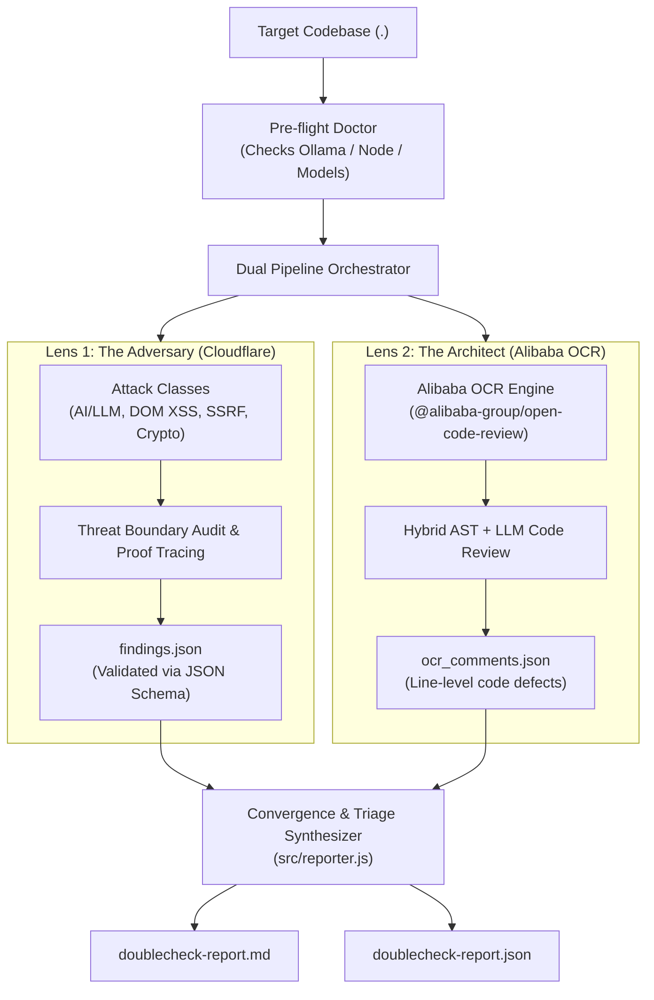

# Design Specification: `doublecheck`

**Project Name:** `doublecheck`  
**Description:** Multi-Perspective Code Security & Architecture Review for Humans and AI Agents.  
**Date:** 2026-10-23  
**Author:** Paulo Ferraz & Antigravity  
**Status:** Approved  

---

## 1. Overview & Value Proposition

Traditional code review and automated scanning suffer from single-lens bias:
- **Linters / AST analyzers** flag style and local syntax bugs, but are blind to trust-boundary violations, prompt injection, and exploit chains.
- **Security penetration tools** find high-level vulnerabilities, but often miss core software engineering defects like null dereferences, unhandled async rejections, memory leaks, and state synchronization races.

`doublecheck` synthesizes two world-class, battle-tested methodologies into a single unified audit engine:
1. **The Attacker (Cloudflare Security Audit Standard):** Multi-phase threat modeling, trust-boundary exploitation, attack classes (`AI-AND-LLM`, `CLIENT-SIDE`, `CLOUD-AND-DEPLOYMENT`, `PROTOCOLS-RPC-AND-MESSAGING`).
2. **The Architect (Alibaba Open Code Review):** Production AST inspection, hybrid static + LLM line-level defect annotations, concurrency bugs, and type coercion traps.

### The Convergence Principle
When both the Penetration Tester (Cloudflare) and the Principal Engineer (Alibaba) independently flag the exact same file and line, `doublecheck` elevates the finding to a **Converged High-Confidence Defect (Priority 0)** requiring immediate remediation.

---

## 2. Target Users & Operating Modes

`doublecheck` provides dual operating interfaces:

1. **Terminal / CI Mode (`npx doublecheck .`):**
   - Zero-configuration executable runner for human developers and CI/CD pipelines.
   - Automatically checks local environment (`ollama`, `node >= 18`).
   - Runs the dual audit pipelines, computes convergence metrics, and outputs clean GitHub Flavored Markdown (`doublecheck-report.md`) and JSON (`doublecheck-report.json`).

2. **Agent Skill Mode (`/doublecheck` or Skill Invocation):**
   - Formatted to the open [Agent Skills specification](https://agentskills.io/specification).
   - Compatible out-of-the-box with **Google Antigravity**, **Claude Code**, **Cursor**, **Windsurf**, and **Codex**.
   - Includes cross-platform conversion script (`scripts/convert.sh`) for rapid agent installation.

---

## 3. System Architecture & Components

### Component Details
1. **`bin/doublecheck.js`**: Executable entry point with Shebang (`#!/usr/bin/env node`).
2. **`src/doctor.js`**: Probes local Ollama (`http://localhost:11434`), checks active models, verifies Node.js version, and confirms tool readiness.
3. **`src/orchestrator.js`**: Executes the Cloudflare threat modeling pass and Alibaba OCR scan either concurrently or sequentially to preserve system resources.
4. **`src/reporter.js`**: Parses findings from both lenses, performs line-range and scope matching, identifies converged defects, and formats a clean Markdown priority matrix.
5. **`skills/doublecheck/SKILL.md`**: Formal Agent Skill specification with YAML frontmatter, execution instructions, and reference links.
6. **`skills/doublecheck/references/`**: Standalone reference guides for attack classes, rulesets, and convergence rubrics.
7. **`scripts/convert.sh`**: Transpiles `SKILL.md` and reference guides into runtime-specific configurations (`.claude/`, `.cursor/rules/`, `prompts/`, etc.).

---

## 4. Local-First & Zero-Cost Model Policy

- **Default Backend:** 100% Local Ollama (`http://localhost:11434/v1`) using high-capability open coding models:
  - `deepseek-v4.1-flash:1017-cloud`
  - `qwen2.5-coder:14b` / `qwen2.5-coder:32b`
  - `mistral-large-4:cloud`
- **Zero Mandatory API Keys:** No remote cloud tokens or subscriptions are required to run a full dual audit.
- **Optional Cloud Provider Support:** Users with OpenAI, Anthropic, or OpenRouter API keys can pass `--provider openai --key <token>` if local inference hardware is unavailable.

---

## 5. Output Contract & Report Format

`doublecheck` produces a structured report containing:
1. **Executive Scorecard:** High-level posture assessment, files reviewed, and total defects discovered.
2. **Convergence Matrix:** Side-by-side comparison of defects where both engines flagged the same line or component.
3. **Priority 0 (Immediate Fixes):** Proof-backed vulnerabilities and critical code crashes with ready-to-use drop-in code snippets.
4. **Priority 1 (High Quality & Hygiene):** Logic bugs, unhandled promise rejections, type safety issues, and injection normalizer gaps.
5. **Priority 2 (Defensive Hardening):** Permission over-privilege, dead code, and performance optimizations.

---

## 6. Project Scaffolding & Public Repository Setup

- **Repository:** `poferraz/doublecheck` (Public on GitHub)
- **License:** Apache License 2.0 (Open Source, permissive)
- **Quality Gates:**
  - Vitest automated unit test suite for doctor, orchestrator, and reporter.
  - GitHub Actions CI matrix running on Node 18, 20, and 22.
  - Pre-commit hygiene and zero secret leaks.
