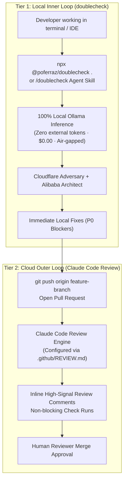

# Multi-Layer Defense-in-Depth Architecture

This manual documents the dual-tier security architecture connecting `doublecheck`'s local audit engine with Anthropic's [Claude Code Review](https://code.claude.com/docs/en/code-review).

---

## 1. The Two-Tier Paradigm

Security audits cannot rely solely on pre-commit linters or solely on remote pull request checks. Effective software defense requires a defense-in-depth model that addresses both speed, sovereignty, and multi-agent cloud verification:



### Tier 1: Local Inner Loop (`doublecheck`)
- **Execution Target:** Workstation terminal, Cursor IDE, Google Antigravity, Claude Code terminal CLI.
- **Inference Policy:** 100% local via Ollama (`deepseek-v4.1-flash`, `qwen2.5-coder:14b`, or `mistral`).
- **Cost & Privacy:** **$0.00**, zero external network tokens, zero intellectual property leaves the machine.
- **Mission:** Catch high-confidence converged vulnerabilities (P0) at the point of creation before code is ever staged or pushed.

### Tier 2: Cloud Outer Loop (Claude Code Review)
- **Execution Target:** GitHub Pull Request check runs triggered automatically on branch updates.
- **Inference Policy:** Multi-agent cloud execution contextually scanning branch diffs against full repo ASTs.
- **Cost & Integration:** Configured via Claude Team/Enterprise GitHub app.
- **Mission:** Team-wide governance, cross-file impact analysis, regression checks, and persistent PR annotations.

---

## 2. Bridging Standards via `REVIEW.md`

Claude Code Review reads repository instructions from `.github/REVIEW.md` to tune its evaluation criteria, severity definitions, and file exclusions.

`doublecheck` translates its dual-lens methodology directly into `REVIEW.md` through:
1. **The CLI Generator:**
   ```bash
   npx @poferraz/doublecheck --init-review
   ```
2. **The Distribution Converter:**
   ```bash
   bash scripts/convert.sh review-md
   ```

When `.github/REVIEW.md` is present in a repository, Claude Code Review automatically enforces:
* **Adversary Attack Classes:** Prompt injection, DOM XSS sinks, SSRF vectors, and cleartext credential leaks.
* **Architect Invariants:** Null safety guards, unhandled async promise rejections, and type coercion traps.
* **Convergence Escalation:** Any defect flagged by both paradigms is escalated to Blocker (P0).

---

## 3. Triangulation & Consensus Heuristic

When reviewing pull requests:
- **Inner Loop Green, Outer Loop Red:** Check for whole-repository side effects or breaking cross-module contract changes that single-file local audits missed.
- **Inner Loop Red, Outer Loop Missed:** The local Ollama model found an exploit chain (e.g., Cyrillic homoglyph bypass) that generalist models overlooked; maintain the P0 blocker.
- **Both Loops Flag Same Line:** Near 100% defect confidence. Requires immediate patch before merge.
